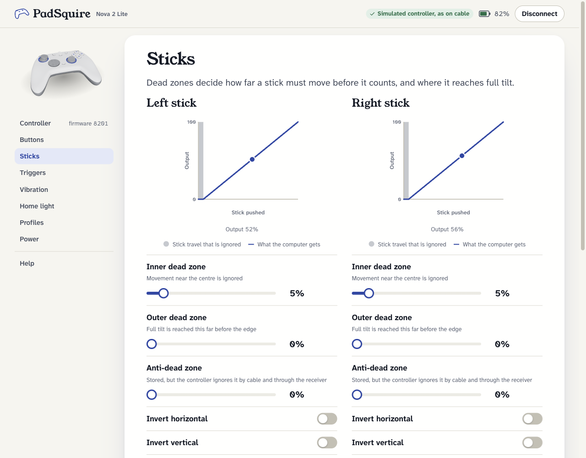

# gamesir-linux

Configure and update the GameSir **Nova 2 Lite** on Linux, without Windows or GameSir Connect.
Unofficial: built by reverse-engineering GameSir Connect (Windows) and the GameSir Android app.



## What it does

- **A settings app in your browser** (`gamesir-linux gui`). It finds the controller by itself when
  you plug it in, and shows every setting with the controller drawing as the map. Dead zones are
  drawn as you drag, with the live stick or trigger position on top. On the Buttons page, the
  buttons you press light up as the computer receives them.
- **Every setting GameSir Connect has for this controller.** That covers dead zones, stick
  options, button remapping (19 buttons, each to any other), vibration strength with a test per
  motor, the Home light and quick triggers.
- **Firmware updates**, for the controller and its 2.4 GHz receiver. The app installs GameSir's
  own firmware exactly as GameSir Connect does, after a full backup of the device. See
  [Firmware updates](#firmware-updates).
- **Setup and help** inside the app. It checks what your computer still needs and gives the
  command for each item, with what every part does and links to its documentation, plus
  answers for when something doesn't work.

| | Cable | 2.4 GHz receiver | Bluetooth |
|---|---|---|---|
| Read and change settings | yes | yes | built, not tested on hardware yet |
| Remap every button | yes | yes | back buttons only, not tested |
| Live sticks, triggers and buttons | yes | yes | no |
| Controller firmware update | yes | no (use the cable) | no |
| Receiver firmware update | | yes | |

Tested on one Nova 2 Lite (firmware 7701 and 8201) and its receiver (firmware 2800).

## Get started

You need Linux with Python 3.11 or newer, and git.

```sh
git clone https://github.com/Magniswerfer/gamesir-linux
cd gamesir-linux
python3 -m venv .venv
.venv/bin/pip install -e '.[gui]'
.venv/bin/gamesir-linux gui
```

What these do:

- `git clone` downloads this project and `cd` goes into its folder.
- `python3 -m venv .venv` makes a private Python environment in the `.venv` folder, so nothing
  is installed system-wide ([venv](https://docs.python.org/3/library/venv.html)).
- `pip install -e '.[gui]'` installs gamesir-linux into that environment, with the extras the app
  needs: aiohttp for the web server and bleak for Bluetooth
  ([pip install](https://pip.pypa.io/en/stable/cli/pip_install/)).
- `gamesir-linux gui` starts the app and opens it in your browser.

Then open **Setup and help** in the app. It tells you what's still missing, usually a one-time
permission rule so the controller can be used without `sudo`, and explains each command before
you run it. Optional: `ln -s "$PWD/.venv/bin/gamesir-linux" ~/.local/bin/` puts `gamesir-linux`
on your PATH. For an app-menu entry, copy `contrib/desktop/gamesir-linux.desktop` to
`~/.local/share/applications/`.

The app runs on `127.0.0.1` only and opens a one-time link. Other websites in your browser can't
reach it: the server rejects requests without the link's session cookie, requests for any other
host name, and API calls without a custom header. Fonts are bundled, so nothing loads from the
internet.

## Connect the controller

- **By cable:** plug it in and hold **View + Menu** for 2 seconds until the Home light is
  **green** (PC/Xbox mode). Each press moves to the next mode: green, red (Switch), blue
  (PlayStation). In blue mode it pretends to be a DualShock 4 and can't be configured.
- **Through the 2.4 GHz receiver:** plug the receiver in, turn the controller on, wait for it to
  link, then switch it to green the same way.
- **Over Bluetooth:** hold **Home + A** for 2 seconds until the light flashes **yellow** (Android
  mode), pair it in your system's Bluetooth settings, then use **Find controllers** in the app.

## Firmware updates

On the app's **Firmware** page: download the firmware (fetched from GameSir's own update feed and
checked against its checksums), switch the controller or the receiver to update mode, make a
backup, install, restart. The controller's firmware is installed by cable; the receiver's through
the receiver itself.

What keeps it safe:

- **A backup first.** The whole flash is read twice and compared before anything is written, and
  every write needs a backup of the same device. The backup is also your way back: writing it
  back restores the old firmware.
- **Only the firmware area is written.** Settings, the Bluetooth address and pairing, and the
  factory stick calibration are never touched, and the whole flash is compared before and after.
- **Every block is checked** against the device's own checksum. A failed write keeps the device
  in update mode so it can be done again; it is never restarted half-written.
- Writes follow the same order as GameSir's own updater, and use only "erase a block" and "write
  a block". The command that burns the chip's key can't be sent.

Backups are kept in `~/.local/share/gamesir-linux/backups`, readable only by you. They contain
your controller's Bluetooth pairing and calibration: copy them somewhere safe, and don't share
them.

Still unknown: how to reach update mode if the firmware itself no longer starts. The ways in all
go through the firmware. That's why a failed write is never followed by a restart.

## Known firmware quirks

Found on firmware 8201. The app works around each one:

- **Six on/off settings can't be changed by cable or receiver.** They are low battery warning,
  play while charging, swap sticks, invert sticks X/Y, swap LB/LT and swap RB/RT. The controller
  keeps its value. The app shows them read-only. Bluetooth is not tested yet.
- **Outer dead zone above 25% is broken.** The stick at full tilt comes out on the opposite side.
  The app stops at 25%.
- **The anti-dead zone has no effect by cable or receiver.** The controller stores the value
  but doesn't use it. Bluetooth is not tested yet.
- **Vibration strength goes in steps of 25%.** Other values are rounded down. The Nova 2 Lite has
  two vibration motors, in the grips, and none in the triggers.
- **Remapping takes buttons only:** a button can't act as a stick direction or be switched off.
- **Sometimes the controller stops responding right after a change**, mostly through the receiver.
  The change is kept, and a restart fixes it; the Buttons page has a button for that.
- Auto-sleep and profiles get no answer by cable or receiver.

## Command line

Everything in the app also works from a terminal:

```sh
gamesir-linux usb info                              # firmware, battery, MAC
gamesir-linux usb deadzone left-stick-inner 3       # set a dead zone (percent)
gamesir-linux usb vibration --left-grip 50 --right-grip 50
gamesir-linux update                                # fetch the newest firmware
gamesir-linux uboot --help                          # update mode: backup, restore, flash, restart
```

`usb` works by cable and through the receiver; `ble` does the same over Bluetooth, and
`--simulate` tries any command without a controller. `gamesir-linux --help` lists everything. For
automatic weekly firmware checks there is a systemd timer in `contrib/systemd/`.

## How it works

In green mode the controller shows up as `3537:100F` by cable, or `3537:1098` through the
receiver, with a vendor HID interface. GameSir Connect talks to it in 64-byte reports using the
same "GCM" protocol the Android app uses over Bluetooth, so one client drives all three. Firmware
updates use the chip's built-in USB update mode (JieLi "UBOOT1.00"), where the device shows up as a
USB disk that takes special commands. All the details are in [PROTOCOL.md](PROTOCOL.md); testing
on hardware is described in [HARDWARE.md](HARDWARE.md).

## Tests

```sh
.venv/bin/pip install -e '.[gui,test]'
.venv/bin/pytest
```

The repository contains no GameSir files. Tests build synthetic firmware files, installers,
flash images and sysfs trees shaped like the real ones. They replay replies captured from a real
controller, and include a fake chip in update mode for the firmware writer.

## Roadmap

- Test Bluetooth on hardware, including the six settings refused by cable.
- Find the cause of the occasional stop after a change.
- Remap one button to several pressed together (the controller supports it; the app doesn't yet).
- Controller firmware updates through the 2.4 GHz receiver (JieLi's over-the-air updater, which
  GameSir Connect doesn't use for this controller): research.
- Other GameSir controllers.

## Disclaimer

Unofficial and not affiliated with GameSir. Firmware updates can brick hardware. The safety
checks above reduce that risk but cannot remove it. Tested on one controller and one receiver so
far. MIT licensed; see [LICENSE](LICENSE).
